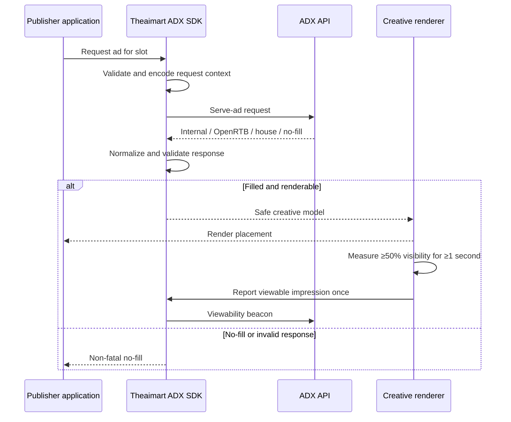

# Theaimart ADX SDKs

**Official SDKs and integration libraries for monetizing web, mobile, desktop, server, and game applications with Theaimart ADX.**

[](https://pypi.org/project/theaimart-adx/)
[](https://www.npmjs.com/package/@theaimart/adx)
[](https://crates.io/crates/theaimart-adx)
[](https://pub.dev/packages/theaimart_adx)
[](LICENSE)

[ADX Platform](https://adx.theaimart.co) · [Developer Documentation](https://adx.theaimart.co/docs) · [SDK Hub](https://adx.theaimart.co/developers) · [Report an Issue](https://github.com/theaimartco/theaimart-adx-sdks/issues)

</div>

---

## Overview

This repository is the canonical home for Theaimart ADX client SDKs. Each SDK implements the same versioned advertising contract for:

- requesting an advertisement for a configured placement;
- normalizing internal, OpenRTB, house-ad, and no-fill responses;
- rendering or exposing supported creative payloads;
- reporting viewable impressions;
- preserving registered click-tracking flows;
- forwarding platform, page, privacy, and end-user context safely;
- failing closed when networking, parsing, or rendering fails.

The SDKs are intentionally thin. Advertising must never block, crash, or destabilize the host application.

> [!IMPORTANT]
> Use only public publisher keys beginning with `pk_` in client-distributed applications. Never embed administrative credentials, private infrastructure tokens, database credentials, advertiser billing credentials, or signing keys in an SDK integration.

## Published SDKs

| Runtime | Package | Install | Primary use case |
|---|---|---|---|
| Node.js / TypeScript | [`@theaimart/adx`](https://www.npmjs.com/package/@theaimart/adx) | `npm install @theaimart/adx` | Server-side ad requests and rendering |
| Python | [`theaimart-adx`](https://pypi.org/project/theaimart-adx/) | `pip install theaimart-adx` | Django, Flask, FastAPI, and backend integrations |
| Rust | [`theaimart-adx`](https://crates.io/crates/theaimart-adx) | `cargo add theaimart-adx` | Server-side and transport-controlled integrations |
| Flutter | [`theaimart_adx`](https://pub.dev/packages/theaimart_adx) | `flutter pub add theaimart_adx` | Android, iOS, web, Windows, macOS, and Linux apps |

Additional integration surfaces may exist in this monorepo for Web, React Native, Android, iOS, and Unity. Check the relevant package README and the [SDK Hub](https://adx.theaimart.co/developers) before shipping.

> [!NOTE]
> The canonical published Node.js package is `@theaimart/adx`. Keep package names synchronized across this repository, registry metadata, documentation, examples, and the ADX website before every release.

## Production Guarantees

All production SDK implementations should preserve the following invariants.

### One versioned wire contract

SDK behavior is derived from [`CONTRACT.md`](CONTRACT.md). A platform SDK must not invent incompatible request fields, response shapes, tracking semantics, or retry rules.

### Fail-closed behavior

Network failures, timeouts, invalid status codes, malformed JSON, incomplete responses, unsupported creatives, and tracking failures must degrade to no-fill or a non-fatal tracking failure. An advertisement failure must not interrupt primary application functionality.

### Normalized response model

The backend response is normalized into one ad model covering:

1. internal demand;
2. OpenRTB demand;
3. house advertisements;
4. no-fill or operational failure.

Unexpected response shapes must not escape into rendering code as partially initialized filled advertisements.

### WAF-safe request encoding

Contract-defined free-text values—such as page URLs, keywords, application metadata, consent strings, and identity values—must be encoded consistently before transmission. Do not manually concatenate query strings.

### Fraud-aware identification

Each SDK sends a recognizable SDK User-Agent, for example:

```text
theaimart-adx-<runtime>/<version>
```

Server SDKs must also forward the real end-user User-Agent and client IP when permitted and available. The SDK User-Agent identifies the integration; it does not replace end-user context.

### Viewability before impression reporting

A standard viewable impression requires the advertisement to remain at least 50% visible for at least one continuous second. Managed UI SDKs should measure this automatically. Custom renderers must measure it before calling the viewability endpoint.

### Safe creative handling

- Only intentional user interaction may initiate click navigation.
- Only approved URL schemes should become navigable links.
- HTML and OpenRTB markup should be rendered in a sandboxed iframe or restricted WebView.
- Custom renderers must restrict navigation, JavaScript bridges, file access, and host-application access.
- No-fill must collapse or safely replace the placement.

## Quick Start

Create a publisher property, API key, and ad slot in the [Theaimart ADX publisher dashboard](https://adx.theaimart.co), then use the SDK matching your runtime.

### Node.js / TypeScript

```bash
npm install @theaimart/adx
```

```ts
import { Adx } from "@theaimart/adx";

type AdRequestContext = {
  pageUrl: string;
  userAgent?: string;
  clientIp?: string;
};

const apiKey = process.env.THEAIMART_ADX_API_KEY;

if (!apiKey) {
  throw new Error("THEAIMART_ADX_API_KEY is required");
}

const adx = new Adx({ apiKey });

export async function requestBanner(context: AdRequestContext) {
  const ad = await adx.requestAd({
    slotId: "YOUR_SLOT_ID",
    pageUrl: context.pageUrl,
    userAgent: context.userAgent,
    clientIp: context.clientIp,
  });

  if (!ad.filled) {
    return null;
  }

  return ad;
}
```

Forward client IPs only from trusted proxy or load-balancer metadata. Never trust arbitrary `X-Forwarded-For` values without a configured trust boundary.

### Python

```bash
pip install theaimart-adx
```

```python
import os
from typing import Protocol

from theaimart_adx import Adx


class RequestContext(Protocol):
    headers: dict[str, str]
    url: str


adx = Adx(api_key=os.environ["THEAIMART_ADX_API_KEY"])


def request_banner(request: RequestContext, trusted_client_ip: str | None) -> str:
    ad = adx.request_ad(
        slot_id="YOUR_SLOT_ID",
        page_url=request.url,
        user_agent=request.headers.get("User-Agent"),
        client_ip=trusted_client_ip,
    )

    return Adx.render_html(ad) if ad.filled else ""
```

The Python client is synchronous. In an asynchronous framework, offload blocking network calls according to the framework's concurrency model.

### Rust

```bash
cargo add theaimart-adx
```

```rust
use theaimart_adx::{render_html, AdRequest, Adx};

fn main() {
    let api_key = std::env::var("THEAIMART_ADX_API_KEY")
        .expect("THEAIMART_ADX_API_KEY is required");

    let adx = Adx::new(api_key);
    let ad = adx.request_ad(&AdRequest {
        slot_id: Some("YOUR_SLOT_ID"),
        page_url: Some("https://example.com/articles/production-systems"),
        ..Default::default()
    });

    if ad.filled {
        let html = render_html(&ad, "theaimart-adx-placement");
        println!("{html}");
    }
}
```

The Rust SDK exposes a transport abstraction. Disable the default transport when integrating with a custom `reqwest`, `hyper`, or test transport implementation.

### Flutter

```bash
flutter pub add theaimart_adx
```

```dart
import 'package:flutter/material.dart';
import 'package:theaimart_adx/theaimart_adx.dart';

class MonetizedScreen extends StatelessWidget {
  const MonetizedScreen({super.key});

  @override
  Widget build(BuildContext context) {
    return Scaffold(
      body: Column(
        children: [
          const Expanded(
            child: Center(child: Text('Application content')),
          ),
          SafeArea(
            top: false,
            child: BannerAd(
              apiKey: 'pk_your_publisher_key',
              slotId: 'YOUR_SLOT_ID',
              onAdLoaded: (ad) {
                debugPrint('Filled by ${ad.source}');
              },
              onAdFailed: (reason) {
                debugPrint('No fill: $reason');
              },
            ),
          ),
        ],
      ),
    );
  }
}
```

Use an audited `htmlBuilder` for HTML or OpenRTB creatives. WebView selection, navigation policy, JavaScript configuration, cookies, and platform security remain the host application's responsibility.

## Request Lifecycle



## Wire Contract

The default production API base is:

```text
https://api.adx.theaimart.co
```

Wire contract v1 includes these core routes:

```text
/api/v1/serve/ad
/api/v1/serve/viewable
/api/v1/serve/click
```

Current v1 client defaults:

| Setting | Value |
|---|---:|
| Contract version | `v1` |
| Request timeout | `10 seconds` |
| Minimum automatic refresh interval | `30 seconds` |
| Viewability threshold | `≥50%` |
| Required continuous visibility | `≥1 second` |

Do not shorten refresh intervals or report impressions before viewability merely to increase request or impression counts.

## End-User Context for Server SDKs

A server SDK request should include real request context whenever applicable:

- page or application URL;
- page keywords or placement metadata;
- browser or device User-Agent;
- trusted client IP;
- consent and privacy signals;
- identity value, where permitted;
- configured slot ID or supported slot name.

Without end-user context, all traffic may appear to originate from one backend host, which can reduce targeting quality and produce invalid-traffic signals.

### Trusted proxy boundary

Headers such as the following are attacker-controlled unless they are overwritten by infrastructure you trust:

```text
X-Forwarded-For
X-Real-IP
CF-Connecting-IP
```

Configure IP extraction for your actual CDN, reverse proxy, ingress, or load balancer. Do not accept the first forwarding header value blindly.

## Privacy and Consent

The SDK transports privacy signals supplied by the publisher. It does not determine whether consent is legally required or whether a supplied value is valid.

Publishers remain responsible for:

- determining applicable privacy and advertising requirements;
- collecting and recording valid consent where required;
- respecting opt-out and restricted-processing choices;
- forwarding accurate privacy signals;
- documenting advertising and identity behavior;
- configuring retention, logging, and cookie behavior appropriately.

Do not fabricate consent strings or use identity values contrary to user choice or applicable policy.

## Error and No-Fill Handling

No-fill is a valid advertising outcome. Production applications should:

- keep core content available;
- collapse or replace empty placements;
- avoid uncontrolled retry or refresh loops;
- use contract-provided retry guidance when present;
- treat viewability and click tracking as best-effort, non-fatal operations;
- distinguish expected no-fill from integration errors in observability data.

Do not expose raw backend error messages, API keys, identity values, client IPs, or full creative payloads in user-facing logs.

## Observability

Record operational metadata without collecting unnecessary personal data.

Recommended fields:

```text
sdk_name
sdk_version
contract_version
placement_id
ad_kind
ad_source
filled
no_fill_reason
request_duration_ms
http_status
viewability_reported
click_tracking_generated
```

Avoid logging:

```text
full API keys
raw identity cookies
unredacted client IPs
complete consent strings
private infrastructure headers
full HTML creative payloads
```

## Repository Layout

The monorepo is organized by runtime, with one root wire contract shared across implementations.

```text
.
├── CONTRACT.md
├── LICENSE
├── README.md
├── packages
│   ├── android
│   ├── flutter
│   ├── ios
│   ├── node
│   ├── python
│   ├── react-native
│   ├── rust
│   ├── unity
│   └── web
└── .github
    └── workflows
```

A package may have its own README, changelog, examples, tests, and registry-specific metadata. The root `CONTRACT.md` remains authoritative for cross-platform protocol behavior.

## Development

Clone the repository:

```bash
git clone https://github.com/theaimartco/theaimart-adx-sdks.git
cd theaimart-adx-sdks
```

Run validation from the package being changed.

### Node.js

```bash
cd packages/node
npm ci
npm run build
npm test
```

### Python

```bash
cd packages/python
python -m venv .venv
source .venv/bin/activate
python -m pip install --upgrade pip
python -m pip install -e ".[dev]"
python -m pytest
```

### Rust

```bash
cd packages/rust
cargo fmt --check
cargo clippy --all-targets --all-features -- -D warnings
cargo test --all-features
```

### Flutter

```bash
cd packages/flutter
flutter pub get
flutter analyze
flutter test
```

If a package uses different scripts, its package-level README and manifest are authoritative.

## Testing Requirements

Every SDK must test at least:

- valid internal ad response;
- valid OpenRTB response;
- valid house-ad response;
- valid no-fill response;
- malformed JSON;
- incomplete or unknown response variant;
- timeout and transport failure;
- non-success HTTP response;
- free-text encoding and WAF-sensitive inputs;
- SDK User-Agent construction;
- unsafe click URL rejection;
- duplicate viewability prevention;
- public-key validation where implemented;
- custom base URL behavior;
- contract version compatibility.

UI SDKs must additionally test lifecycle disposal, hidden routes or windows, scrolling, backgrounding, no-fill layout behavior, click deduplication, and platform-specific creative rendering.

## Production Integration Checklist

Before release:

- [ ] Use a real publisher property, public API key, and configured slot.
- [ ] Keep secrets out of mobile, desktop, web, and game binaries.
- [ ] Forward real end-user context through a trusted proxy boundary.
- [ ] Verify filled, no-fill, timeout, malformed-response, and offline behavior.
- [ ] Confirm one viewability report per eligible impression.
- [ ] Verify that ads never cover essential controls or imitate application navigation.
- [ ] Restrict HTML creative execution and navigation.
- [ ] Collapse or replace no-fill placements.
- [ ] Respect privacy, consent, and opt-out state.
- [ ] Confirm SDK and wire-contract versions are compatible.
- [ ] Test every operating system and runtime shipped by the application.
- [ ] Add metrics and redacted logs before enabling production traffic.

## Versioning

SDK packages use semantic versioning.

- Patch releases fix compatible implementation defects.
- Minor releases add backward-compatible SDK capabilities.
- Major releases may change public SDK APIs.
- Wire-contract breaking changes require an explicit contract version change and coordinated SDK releases.

A package version and a wire-contract version are different concepts. Multiple compatible SDK releases may implement the same contract version.

## Contributing

1. Open an issue describing the defect, compatibility change, or new runtime requirement.
2. Keep cross-platform protocol changes in `CONTRACT.md` before implementing them in one SDK.
3. Add or update tests for every behavior change.
4. Run the package's formatter, static analysis, build, and test suite.
5. Update the package changelog and documentation.
6. Avoid unrelated formatting or generated-file changes in the same pull request.

Pull requests that weaken fail-closed behavior, viewability guarantees, URL validation, request encoding, privacy handling, or credential safety should not be merged.

## Security

Do not disclose exploitable vulnerabilities in a public issue.

Report security concerns through the official support channel listed on [theaimart.co](https://theaimart.co) and include:

- affected SDK and version;
- affected runtime or operating system;
- reproducible steps;
- expected and observed behavior;
- impact assessment;
- minimal proof of concept;
- suggested remediation, when available.

Never include real production credentials, raw identity data, or unrelated user information in a report.

## Support

- Documentation: [adx.theaimart.co/docs](https://adx.theaimart.co/docs)
- SDK hub: [adx.theaimart.co/developers](https://adx.theaimart.co/developers)
- Product: [adx.theaimart.co](https://adx.theaimart.co)
- Issues: [GitHub Issues](https://github.com/theaimartco/theaimart-adx-sdks/issues)
- Company support: [support@theaimart.co](mailto:support@theaimart.co)

When requesting support, provide the SDK name, SDK version, runtime version, operating system, contract version, placement type, redacted logs, and a minimal reproduction.

## License

Licensed under the [Apache License 2.0](LICENSE).

Copyright © 2026 Theaimart.